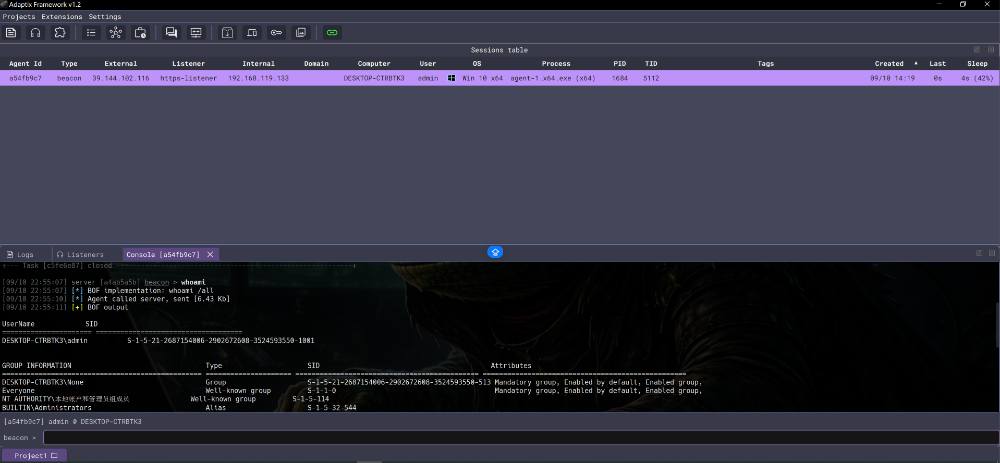

# 0x1 Introduction
This is a Loader, it can convert original Adaptix DLL to shellcode with Crystal Palace and Advanced Evasion Technology

This involves modifying the source code of AadaptixC2, so you need use the modified version AdaptixC2

## 1.1 Crystal Palace
This is a extremely outstanding project, it's author also is the author of Cobalt Strike, Raphael Mudge, to gain a deep understanding, you need read it's source code, below is my short understanding:

Crystal Palace = PICO + Linker

In my opinion, the core of Crystal Palace is linker and PICO, PICO is a reflective loader with hook function, and each evasion technique is compiled into a separate COFF object use GCC compiler, then use the linker link them and generate shellcode

## 1.2 Advanced Evasion
### 1. DLL Encrypt for Static Evasion
use Crystal Palace encrypt original Adaptix DLL
### 2. Section Permission for Memory Evasion
Correct section permission when load into memory, original Adaptix DLL VirtualAllocEx with permission RWX, this is very suspicious
### 3. Module Stomping for Memory Evasion
Implement an enhanced variant of Module Stomping, 
Phantom DLL Hollowing, avoid using VirtualProtect, and ensure the memory is file-backed and the file is deleted.
### 4. Sleep Mask for Memory Evasion
Implement runtime function hooking with PICO of Crystal Palace, replace Sleep、WaitForSingleObject、WaitForMultiObjects to user-defined Ekko Sleep Mask function.
### 5. Call Stack Spoof When Sleep
Register .pdata section, and masquerade RSP, StackBase, StackLimit to achieve sleeping call stack spoof
### 6. CFG Bypass
Register CFG Bitmap use NtSetInformationVirtualMemory
### 7. CET Bypass
Use NtContinue resume from sleep instead of ROP/JOP, can natively bypass CET

# 0x2 Install
## 2.1 Environment Prepare
### Step 1: a vps (recommend Ubuntu 24.04)

### Step 2: install needed tool
```
sudo apt install -y default-jre gcc-mingw-w64-x86-64 clang lld make
```

### Step 3: instll Go 1.25+ from https://go.dev/dl/

You can check dependency use the following command
```
java -version                        # Java 11+
x86_64-w64-mingw32-gcc --version
clang++ --version
go version                           # 1.25+
make --version
```

## 2.2 RuiningLoader Build
### Step 1: grant Crystal Palace executable privilege
```
chmod +x crystal_palace/coffparse crystal_palace/link crystal_palace/piclink crystal_palace/disassemble
```

### Step 2: build coff objects
```
make
```

### Step 3: build Adpatix Service Extender Plugin
```
cd src_service && make
```

# 0x3 Result
